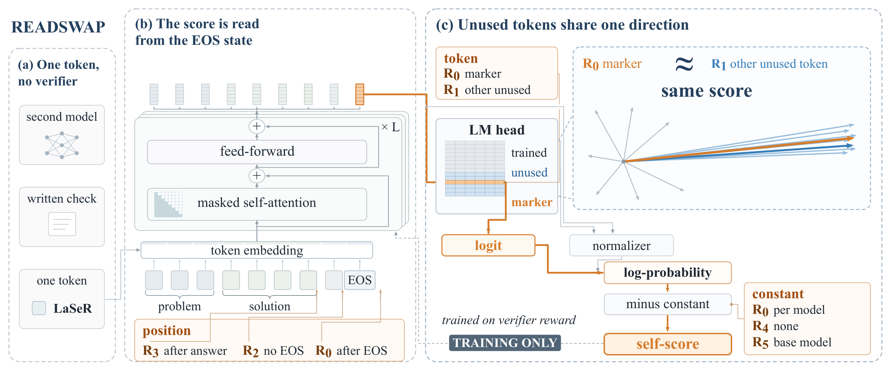

# Almost Any Unused Token Gives the Same Self-Score: Auditing LaSeR's Trained Confidence Token

This repository contains code and data for the paper above (anonymous submission).

<p align="center"></p>

LaSeR trains a reasoning model to score its own solutions with one token: the probability of a special marker
token read after the end of a solution, minus a constant. We read this score in six ways on the same solutions of
the three public LaSeR models and find that it is read off one direction of the output embeddings, which almost all
unused tokens share. Each readout changes one choice:

| Readout | Token | Position | Constant |
|---|---|---|---|
| R0 | marker | after EOS | one per model (LaSeR's own readout) |
| R1 | another unused token | after EOS | one per model |
| R2 | marker | without EOS | one per model |
| R3 | marker | right after the final boxed answer | one per model |
| R4 | marker | after EOS | none |
| R5 | marker | after EOS | the base model's log-probability |

The contrasts L1 to L5 between these readouts were registered before the main runs ([`prereg/`](prereg)).

## Setup

```bash
conda create -n readswap python=3.12 -y && conda activate readswap
pip install -r requirements.txt
```

The Qwen3-4B replication uses a second environment with a newer stack (Python 3.10, `requirements-qwen3.txt`),
and score-only training in Qwen3.5-4B and Gemma-4-12B a third (Python 3.10, `requirements-2026.txt`).
The data figures need `pdflatex` with the `newtx` fonts.

Download the three LaSeR models into `data/models/` and their base models into the Hugging Face cache. The
revisions we used are pinned in [`data/MODELS.json`](data/MODELS.json):

```bash
for m in OctoThinker-3B-Short-LaSeR Qwen2.5-7B-LaSeR ORZ-7B-LaSeR; do
  huggingface-cli download Keven16/$m --local-dir data/models/$m
done
huggingface-cli download OctoThinker/OctoThinker-3B-Short-Base
huggingface-cli download Qwen/Qwen2.5-7B
huggingface-cli download Open-Reasoner-Zero/Open-Reasoner-Zero-7B
huggingface-cli download Qwen/Qwen3-4B                                                      # replications
huggingface-cli download Qwen/Qwen3.5-4B --revision 851bf6e806efd8d0a36b00ddf55e13ccb7b8cd0a
huggingface-cli download google/gemma-4-12B-it --revision 707f0a3b8a3c7ad586ed01e27eafbad8a27dd0f7
git clone https://github.com/RUCBM/LaSeR.git third_party/LaSeR   # LaSeR's own scorer, used by the pilot check
```

## Reproducing the paper

All tables and figures can be rebuilt on a CPU from the analysis files in `results/analysis/`:

```bash
bash code/make_tables_and_figures.sh    # writes outputs/tables/ and outputs/figs/
```

The full pipeline took about 120 GPU hours on one NVIDIA A800 (80 GB):

```bash
bash code/run_pilot.sh             # check our readout against LaSeR's own scorer
bash code/run_generation.sh        # 8 solutions per problem, 3 seeds, 5 benchmarks, graded with Math-Verify
bash code/run_readouts.sh          # readouts R0 to R5 and the registered contrasts L1 to L5
bash code/run_token_sweep.sh       # exploratory controls
bash code/run_eos_swap.sh
bash code/run_mech.sh
bash code/run_extra_controls.sh
python code/q3_prepare.py && bash code/q3_pipeline.sh    # Qwen3-4B replication
bash code/run_new_problems.sh      # AIME26 and HMMT26 (supplementary)
bash code/run_new_models.sh        # score-only training in Qwen3.5-4B and Gemma-4-12B (supplementary)
python code/newdata_analysis.py && python code/unembed_2026.py
bash code/make_tables_and_figures.sh
```

[`docs/reproduction.md`](docs/reproduction.md) lists every step with its inputs and outputs, and
[`docs/paper_map.md`](docs/paper_map.md) maps each table and figure of the paper to the script that makes it.

## Data

- `data/confirmatory/`: the five benchmarks shipped with the LaSeR repository (MATH500, AMC23, AIME24, AIME25,
  OlympiadBench), with sources and licenses in [`data/README.md`](data/README.md).
- `data/new_problems/`: AIME26 and HMMT26 from MathArena (CC BY-NC-SA 4.0), for the supplementary experiments.
- `results/analysis/`: every number reported in the paper, as JSON.
- The per-solution readouts (problem, eight solutions, grades and all six scores) of every run, AIME26, HMMT26
  and the score-only models included, are in a separate archive, `readswap_data.zip`, submitted with the paper. Unzip it in the repository root to run the CPU analyses that
  read them.

## Pre-registration

`prereg/PREREG_v1.json` is the plan and `prereg/AMENDMENT_A1.md` the amendment locked before the first
confirmatory solution. Check them with `cd prereg && sha256sum -c SHA256SUMS SHA256SUMS_A1`. The plan's hash is
printed in Appendix A of the paper; the released amendment differs from the locked file only in line 3, and the
locked file's hash is `a04f5c089ba93688537966e2efc6e374aa4f4b58eb5819a79e4d60a3a95eee00`.

## Code

| Files | What they do |
|---|---|
| `code/generate.py`, `code/grade.py` | sample solutions with vLLM and grade them with Math-Verify |
| `code/readout_fast.py`, `code/readout.py`, `code/readout_r5.py` | compute R0 to R5 for every solution |
| `code/analyze_confirm_a1.py` | registered analysis: contrasts, cluster bootstrap, Holm correction |
| `code/token_sweep.py`, `code/exhaustive_tokens.py` | read many tokens in place of the marker |
| `code/eos_swap_control.py`, `code/eos_vocab.py`, `code/mech_control.py` | replace the EOS token; split the score into logit and normalizer |
| `code/laser_lengthctl.py`, `code/laser_extra.py`, `code/laser_repeat.py` | length, truncation and repetition controls |
| `code/q3_*.py` | Qwen3-4B replication |
| `code/run_new_problems.sh`, `code/run_new_models.sh`, `code/qwen35_4b_*.py`, `code/gemma4_12b_*.py` | AIME26, HMMT26 and score-only training in Qwen3.5-4B and Gemma-4-12B |
| `code/newdata_analysis.py`, `code/unembed_2026.py` | metrics of the runs above; unused-token rows in eight models from 2026 |
| `code/laser_*tables.py`, `code/make_*.py` | tables and figures |
| `tests/` | unit tests: `PYTHONPATH=code python -m unittest discover -s tests` |

`code/common.py` reuses three answer-handling functions of the LaSeR evaluator
([RUCBM/LaSeR](https://github.com/RUCBM/LaSeR), MIT License).

## Citation

```bibtex
@misc{readswap2026,
  title  = {Almost Any Unused Token Gives the Same Self-Score: Auditing {LaSeR}'s Trained Confidence Token},
  author = {Anonymous},
  year   = {2026},
  note   = {Under review}
}
```

## License

The code is released under the MIT License. Data files keep the licenses of their sources.
